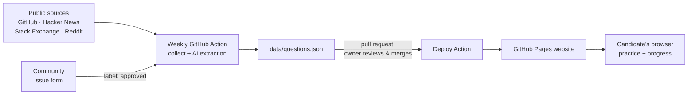

# DataPrep: Design Document

## 1. What it is

A free website where **Data Analyst** and **Data Engineer** candidates practice real interview questions.

- Questions are collected automatically from public sources every week.
- Candidates practice in mock interviews and see which topics need work.
- Everything runs on GitHub: no servers, no database, no hosting bill.

## 2. Goals

| Goal | How |
|---|---|
| Real, up-to-date questions | Weekly automatic collection from public sources |
| Free to run | GitHub Pages + GitHub Actions + free AI tiers |
| Easy to maintain | Questions live in one readable file; changes arrive as pull requests |
| Respect the law and site rules | Only open-licensed data and official APIs; no LinkedIn/Glassdoor scraping |

## 3. How it works

1. **Collect:** an Action fetches posts from public sources every Monday.
2. **Extract:** a free AI model turns each post into clean, standalone questions, tagged by topic, role, difficulty and company.
3. **Review:** new questions arrive as a pull request. The owner merges it to publish.
4. **Publish:** merging triggers a rebuild, and the site updates automatically.

## 4. Main parts

| Part | What it does | Where |
|---|---|---|
| Website | Question bank, mock interviews, progress, companies | `app/`, `components/` |
| Question bank | All questions in one JSON file | `data/questions.json` |
| Collectors | One per source (GitHub, Hacker News, Stack Exchange, Reddit) | `lib/ingest/` |
| AI layer | Extracts questions, writes model answers, grades answers | `lib/ai.ts`, `lib/llm.ts` |
| Automations | Deploy, weekly update, submissions, AI generation, AI check | `.github/workflows/` |

## 5. Data sources

| Source | Access | Why it's allowed |
|---|---|---|
| GitHub repos | Raw files | Only repos with open licenses (MIT, CC BY-SA) |
| Hacker News | Official API | Public, no key needed |
| Stack Exchange | Official API | Content is CC BY-SA; author + link kept |
| Reddit | Official API (needs free app key) | Within Reddit's API terms |
| Community | GitHub issue form | Users share willingly; owner approves |

**Not used:** LinkedIn, Glassdoor, LeetCode Discuss. Their terms forbid scraping.

## 6. Key decisions

- **Static site, no backend.** Free hosting, nothing to break or patch. Trade-off: no user accounts.
- **Progress saved in the browser.** Private and free. Trade-off: it doesn't sync across devices.
- **Questions in a JSON file, not a database.** Every change is visible and reviewable as a normal diff.
- **Pull requests as moderation.** The owner approves new content before it goes live.
- **Free, swappable AI.** Works with any OpenAI-compatible provider: Groq, Gemini, OpenRouter, GitHub Models or Ollama. Change one setting to switch.
- **Works without AI.** If no AI key is set, keyword rules extract questions instead (lower quality) and self-grading replaces AI grading.

## 7. Website features

- **Question bank:** search and filter by role, topic, difficulty, source and company.
- **Mock interview:** one question at a time, balanced across topics; low-scored questions come back more often.
- **Grading:** compare with a model answer and self-rate, or get AI feedback using a free key (score, strengths, gaps, better answer, follow-up question).
- **Progress:** average score, weakest topics, recent sessions.
- **Companies:** questions grouped by the company that asked them.
- **Share an interview:** link to the GitHub issue form.
- **Tutorial:** a 2-minute captioned video tour (`public/tutorial.mp4`).

## 8. Limits and risks

| Limit / risk | Mitigation |
|---|---|
| Free AI tiers allow ~150 requests/day | Several posts per request, spaced calls, leftovers carried to next run |
| AI can misread a post | Every update is reviewed in a pull request before publishing |
| Progress lost if browser data is cleared | Stated clearly on the site; accounts are a future option |
| Visitor AI keys stored in the browser | Optional, never sent to us; warning shown not to use shared computers |
| Sources may change their APIs | Each collector is separate; a failure in one doesn't stop the others |

## 9. Future ideas

- User accounts so progress syncs across devices.
- Built-in SQL sandbox to run answers against sample data.
- More roles (Data Scientist, BI Developer, Analytics Engineer).
- More open-licensed question sources.
